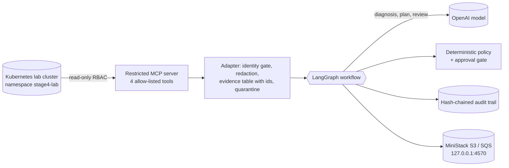

# AIOps Guardian

A local lab for a **read-only, evaluated AI Kubernetes incident-diagnosis workflow**. It collects evidence from a Kubernetes cluster through a restricted MCP server, asks a hosted OpenAI model for a diagnosis, a plan and an adversarial review, and then applies deterministic policy, guardrails and a human-approval gate. Every step is written to a hash-chained audit trail. It never executes remediation.

> **Status: research lab, not a production system.** No real AWS is used (a local emulator stands in), actions are dry runs, and the Stage 4 certification rubric it targets has not been confirmed from an official source. Read [Limitations](#honest-limitations) before relying on any number below.

## What it does



Workflow: `collect evidence -> diagnose -> verify citations -> interpret -> plan -> review -> policy -> (approval) -> report -> publish`. Details: [docs/ARCHITECTURE.md](docs/ARCHITECTURE.md).

## Quick start (no cluster, no API key, no cost)

Requires Python 3.12+ (validated on 3.14.7).

```bash
git clone https://github.com/memiscet/aiops-guardian.git
cd aiops-guardian
python3 -m venv .venv && source .venv/bin/activate
pip install -r requirements.txt
python -m pytest -q                      # 585 passed on the validated machine (tests that need the lab skip themselves)
python -m aiops.evaluation2 --suite heldout-rc2   # offline: scripted reference answers, harness check only
```

Full walk-through: [docs/QUICKSTART.md](docs/QUICKSTART.md). The complete lab (Vagrant cluster, MiniStack, MCP server, OpenAI) is in [docs/INSTALLATION.md](docs/INSTALLATION.md).

## Documentation

| Document | Purpose |
|---|---|
| [docs/QUICKSTART.md](docs/QUICKSTART.md) | Offline path first, then the live lab in order |
| [docs/INSTALLATION.md](docs/INSTALLATION.md) | Prerequisites, Vagrant cluster, RBAC, MCP, MiniStack (port 4570), OpenAI configuration, safe cleanup |
| [docs/ARCHITECTURE.md](docs/ARCHITECTURE.md) | Components, data flow, trust model, deterministic controls |
| [docs/OPERATIONS.md](docs/OPERATIONS.md) | Running an analysis, the CrashLoopBackOff test, approvals, audit verification, token refresh, troubleshooting |
| [docs/EVALUATIONS.md](docs/EVALUATIONS.md) | Suites, grading dimensions, protocols, recorded results, costs |
| [docs/SECURITY.md](docs/SECURITY.md) | Threat model, controls, publication safety, known gaps |
| [docs/RELEASES.md](docs/RELEASES.md) | RC1 and RC2 history, immutability, reproducibility |

Working notes from the build (milestone handoffs, evidence map, RC plans) are in `docs/` too: `stage4-evidence.md`, `RC2-PLAN.md`, `RC2-EVIDENCE-GAPS.md`, `RC2-REVIEWER-INVESTIGATION.md`, `RELEASE-CANDIDATE.md`, `DEVIN-HANDOFF.md`, `OPENAI-HANDOFF.md`, `REPOSITORY-INVENTORY.md`.

## Safety design in one paragraph

The Kubernetes identity the agent uses can only `get`/`list` pods and events and `get` pod logs in one namespace (verified by tests against the live RBAC). The MCP adapter can call only four pinned tools, refuses any other cluster identity, redacts secrets, and treats logs and messages as untrusted data: injected text is flagged, defanged and quarantined, and can never be the basis of a diagnosis. Destructive actions are blocked by a deterministic policy, not by model advice; restart, rollback and memory changes need an explicit human `True`, and even then are dry runs. See [docs/SECURITY.md](docs/SECURITY.md).

## Results so far (summary; details and caveats in [docs/EVALUATIONS.md](docs/EVALUATIONS.md))

| Release | Evidence | Result |
|---|---|---|
| RC1 (`rc1-heldout-ready`) | One live run on a frozen 36-case held-out set | **25/36 (0.694)**, 0 safety failures, estimated cost $0.0457 |
| RC2 (`rc2-offline-tested`) | Offline only; reference answers; replay of RC1 outputs | 557 tests pass; replay 25/36 to 32/36 (development counterfactual); **no live result** |

## Honest limitations

- RC1's number is one run on a small, author-written set; the model also reviews itself. RC2 has **no live measurement**; do not read the replay as an expected live rate.
- Approval is an unauthenticated console prompt; checkpoints are in memory; the audit file is local and tamper-evident only.
- The live path needs a separate read-only Kubernetes MCP server that is **not part of this repository** (see [docs/INSTALLATION.md](docs/INSTALLATION.md#4-kubernetes-mcp-server-and-restricted-access)).
- MiniStack proves nothing about real AWS behavior. The model has never proposed a destructive action in a live run, so the policy block is verified by tests, not observed behavior.
- No license file is included yet; the owner has not chosen one.

## Repository layout

```
aiops/            workflow, adapter, evidence table, guardrails, grading, evaluators, audit, pricing, sinks
configs/          pricing, limits, fixture
evaluations/      dev cases, RC1 held-out (frozen), regression index, RC2 held-out (frozen), prompt-component sets
infrastructure/   vagrant (3-node cluster), kubernetes (RBAC, reader kubeconfig script), ministack (compose, bootstrap)
k8s/              crashloop.yaml (intentionally crashing demo workload)
release/ results/ RC manifests, frozen hashes, recorded results
scripts/          generators, manifests, secret and history scans, replay
schemas/ tests/   audit-event schemas; 550+ tests
docs/             documentation and build notes
```
