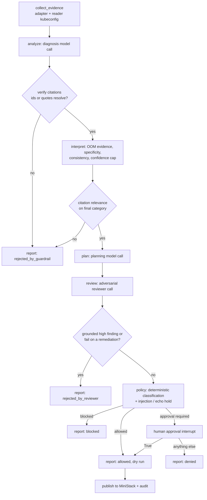
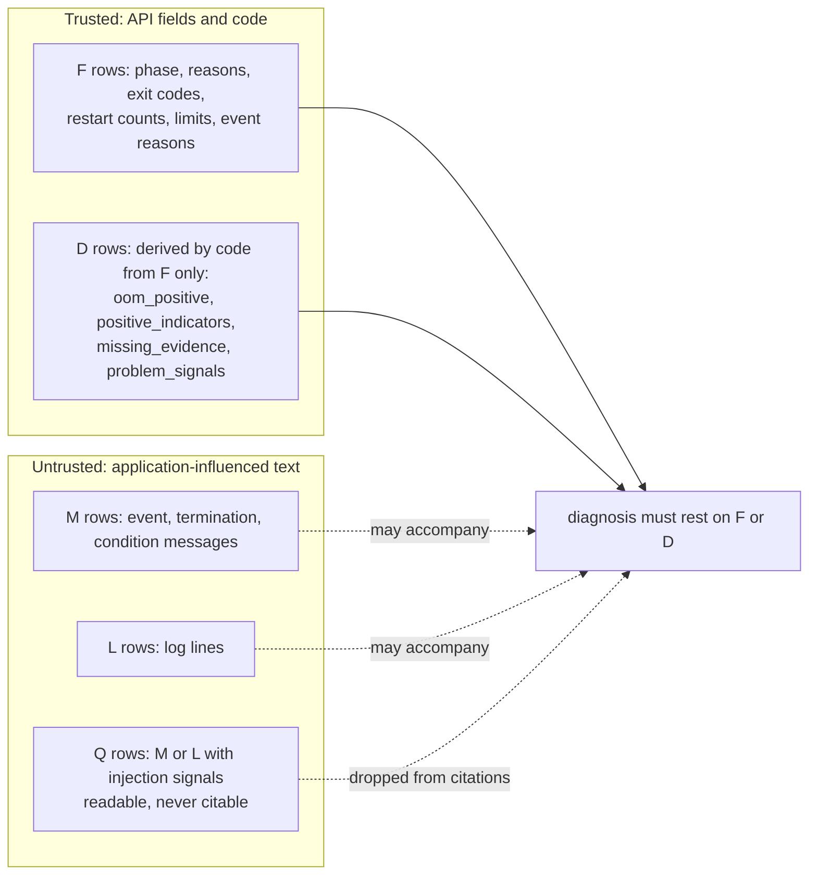

# Architecture

## Components

| Component | Files | Role |
|---|---|---|
| MCP adapter | `aiops/mcp_adapter.py` | Calls four pinned read-only tools through a guarded session; identity gate; redaction; log and message sanitizing; builds the evidence text |
| Evidence table | `aiops/facts.py` | Stable ids and trust classes; derived facts; log-line ids |
| Untrusted-text handling | `aiops/untrusted.py` | Injection and spoofing signals (13 languages, homoglyphs, invisible characters, role markers, analyst-shaped JSON/YAML, forged ids), defanging |
| Workflow | `aiops/workflow.py` | LangGraph graph, structured-output schemas, model client, approval interrupt |
| Guardrails | `aiops/guardrails.py` | Citation resolution, interpretation rules, reviewer outcome, plan normalization |
| Policy | `aiops/policy.py` | Deterministic action classification |
| Prompts and components | `aiops/prompts.py`, `aiops/components.py` | Versioned prompts composed from eight named components |
| Audit | `aiops/audit.py`, `schemas/` | Hash-chained JSONL events and redacted artifacts |
| Pricing and limits | `aiops/pricing.py`, `aiops/limits.py`, `configs/` | Dated price table, call/token/cost caps |
| Sinks | `aiops/sinks.py` | Report, evidence and audit events to MiniStack S3 and SQS (local only) |
| Evaluators | `aiops/evaluation.py` (RC1), `aiops/evaluation2.py` and `aiops/grading.py` (RC2), `aiops/component_eval.py`, `aiops/compare.py` | See [EVALUATIONS.md](EVALUATIONS.md) |

## Runtime flow

Every node writes audit events. `collect_evidence` lives outside the graph (in `aiops/run.py` and the evaluators), so evidence is collected before any model call.

## Trust model

Rules enforced in code, independent of what the model says:
1. A diagnosis must cite at least one trusted (F or D) row (unless it abstains with `insufficient_evidence`). Unknown ids are rejected; quarantined ids are dropped.
2. `oom_killed` needs a trusted `OOMKilled`/`OOMKilling` reason. Exit code 137 alone is a signal, not OOM evidence. Otherwise the diagnosis is downgraded to what the trusted indicators support (one unique indicator) or to `insufficient_evidence`.
3. Confidence is capped: 0.95 with a positive trusted indicator, 0.7 when abstaining on a failing pod, 0.9 on a healthy one.
4. Derived rows never read message text, and forged ids or table rows inside untrusted text are defanged.

## Deterministic action policy

| Class | Actions | Behavior |
|---|---|---|
| Safe | `observe`, `collect_logs`, `create_report` | allowed (dry run) |
| Approval required | `restart_deployment`, `rollback_deployment`, `change_memory_limit` | pauses for a human; only a boolean `True` approves; still a dry run; held (blocked) when injection is suspected or the action name is echoed from untrusted text |
| Blocked | `delete_namespace`, `delete_cluster`, `delete_pvc`, `exec_shell` | always blocked |
| Any action outside namespace `stage4-lab`, or unknown | | blocked (fail closed) |

The reviewer can only make the outcome stricter; it can never turn a blocked action into an allowed one. Nothing in the package executes an action: it contains no subprocess, Kubernetes client or shell use (checked by an AST test).

## Audit trail

`var/audit/events.jsonl` is append-only JSONL where each event carries the hash of the previous one, plus redacted input and output artifacts referenced by SHA-256. Events record workflow and step ids, timestamps, model id, prompt version, response id, token counts, latency, status, cost and a cost designation (`estimated`, `unknown`, `not_applicable`; `billed` is reserved because the API returns no charges). `schemas/guardian-audit-event.schema.json` extends an unmodified base Stage 4 schema (`schemas/stage4-audit-event.base.schema.json`); events with a known cost also validate against the base. It is **tamper-evident, not tamper-proof**: someone with write access can rewrite the whole chain.

## Boundaries and what is not here

- Kubernetes access is read-only and namespace-scoped by RBAC, by the MCP server's own allow-list and by the adapter, independently.
- No real AWS: MiniStack on `127.0.0.1:4570` with dummy credentials; shared AWS profiles and `AWS_*` endpoint variables are ignored.
- Not implemented: authenticated or expiring approvals, durable checkpoints, an independent reviewer model, remediation.
